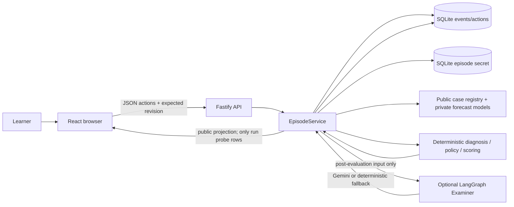
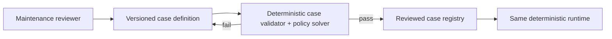

# TwinSleuth — Project Technology Audit

**Audit date:** 2026-10-12  
**Repository revision:** `4f90dec5fdd46021f4bd75da6e645f080970ccf9` (`main`)  
**Scope:** project and ecosystem investigation. No application source, configuration, dependencies, database, or Git history were changed. `npm run build` regenerated the ignored `dist/` build output as required by the repository verification gate; this report is the only new non-generated project document.

**Status update (2026-10-15):** The project was submitted to Next Byte Hacks V5. The current submission copy, video link, and remaining event-page discrepancies are tracked in [submission/HACKATHON-CHECKLIST.md](submission/HACKATHON-CHECKLIST.md); this audit remains a point-in-time record of the repository and event fit as of October 12.

## 1. Executive Summary

TwinSleuth is a local browser lab for practicing evidence-based diagnosis against two authored industrial fault simulations: PIN-9 Refusal and Conveyor Index Drift. Learners commit forecasts for all causes before a test, spend a simulated 30-minute budget, observe server-selected outcomes, defend a diagnosis with evidence claims, and receive a deterministic score and debrief. It is not an industrial digital twin, control system, financial product, or validated learning intervention.

Its strongest engineering asset is a small deterministic diagnosis engine behind a server-owned boundary. Private truth and forecast matrices stay in server code; the browser sees public case facts and only revealed observations. The engine checks predictions, evidence consistency, probe costs, an optimal policy, evidence claims, and score. SQLite stores an append-only event sequence; current public state is folded from those events. The Skeptic is intentionally a deterministic template. Gemini is optional, post-lock Examiner prose only.

The major risks and opportunities are:

1. **Competition fit is unresolved.** Repository material says Devpost and lists generic judging categories, but names no organizer, event, track, or official rubric. Confirm the actual evaluation target before spending effort on contest-specific polish.
2. **The product has engineering evidence, not learning evidence.** It has two small authored cases and strong local correctness checks, but no instructor-reviewed case-quality record, learner cohort, assessment instrument, or measured transfer/retention outcome. A retrieval-and-feedback workflow is plausible; this repository cannot claim that it improves diagnosis skill.
3. **Preserve the deterministic core and no-provider demo.** Adding an LLM, agent framework, or classifier to select probes, determine truth, grade reasoning, or control state would reduce assurance without filling a measured need. The current model feedback path is unbenchmarked and externalizes learner justification when enabled.
4. **High-value next work is bounded:** resolve competition intent; align all submission copy with current implementation; validate case content with an industrial educator; add deterministic replay/property checks; then run a small, consented learning pilot before considering ML.

## 2. Project Dossier

### Problem and users

The stated user is a technical learner practicing fault diagnosis. The scenario presents symptoms, possible causes, probe choices, costs, and observed outcomes. The instructional target is the process: make a prediction, choose a discriminating test, update beliefs from evidence, and explain a diagnosis. The app is local browser practice; it does not connect to factory controllers, sensors, maintenance systems, or real equipment.

### Current capabilities

- Two case definitions are in `src/server/case-model/registry.ts`: four-cause PIN-9 Refusal with six probes, and four-cause Conveyor Index Drift with five probes.
- Both model matrices pass `npm run validate:case`. The solver reports expected and worst-case policy cost of 12.5 and 15 minutes respectively for each case, within a 30-minute budget.
- The browser lets learners maintain possible causes, forecast each cause’s result before a probe, respond to the Skeptic, execute safe simulated probes, submit a diagnosis and structured evidence claims, and inspect a score/debrief.
- The score is computed server-side and decomposed into diagnosis, evidence sufficiency, prediction accuracy, probe quality/cost, and reasoning claims. Probe costs and observed outcomes are checked against the authored server model.
- Local episode history, redacted JSON export, and deletion are available. SQLite persists episodes until deletion or database-file removal; there is no automatic retention schedule or multi-user ownership.
- The flow works without a provider key. Optional Gemini Examiner feedback is requested only after diagnosis/evaluation and is limited to a 20-second attempt timeout, one retry, a 500-character schema bound, and deterministic fallback.

### Technical research stream

The supported research stream is **diagnostic reasoning pedagogy, simulation-based deliberate practice, deterministic decision support, and trustworthy advisory AI**. The engine’s main contribution is not a novel model: it is the explicit, inspectable prediction → test → evidence → diagnosis loop with an auditable scoring/policy model and deliberate authority boundaries. React, Fastify, SQLite, LangGraph, and Gemini are delivery choices.

The closest educational research does not validate TwinSleuth specifically. FAMULUS studies diagnostic-reasoning feedback and annotation in medical and teacher-education settings; it reports two user studies but also frames automated text analysis as technically difficult. A separate diagnostic-reasoning paper describes a 1,200-text cross-domain corpus and found that standard aggregate metrics concealed errors in separating overlapping reasoning activities. These findings support measuring task-specific feedback quality and human annotation agreement; they do not establish learning gains in industrial maintenance learners. [FAMULUS paper](https://arxiv.org/abs/1908.11254) · [Schulz et al. paper](https://arxiv.org/abs/1811.10550)

## 3. Repository and Architecture Audit

### Verified stack and shape

| Area | Verified implementation |
|---|---|
| Language/runtime | TypeScript/ES modules; Node.js 22+ (`package.json`) |
| Browser | React 19, Vite 8, CSS, GSAP; responsive and keyboard/accessibility checks in Playwright |
| API | Fastify 5; same-machine Vite proxy to API on loopback |
| Persistence | `better-sqlite3`, WAL mode; episode, secret, event, and idempotency tables |
| Validation | Zod request/response schemas; strict action payloads and bounded body size |
| Decision logic | Local TypeScript engine: forecast consistency, probe partitioning, budget-constrained optimal policy, claim checking, deterministic score |
| AI integration | Direct `fetch` to Google Gemini API for optional Examiner only; LangGraph wraps Examiner retry/fallback. Skeptic is plain deterministic TypeScript. |
| Tests and build | Vitest, Playwright, axe-core, Vite build; no repository CI workflow was found in the inspected root tree. |
| Deployment | Local single-process development setup. No production `start` script or static `dist` serving path was found. |

The codebase graph indexed 249 nodes and 534 edges. It identifies the engine as the high-fan-in core, with the server as entry layer. The graph’s module inference is useful navigation, but actual files and tests remain the evidence.

### Architecture map

### Main execution path traced in source

1. The browser requests a case and posts an episode start. `src/server/app.ts` validates the body and case ID; `EpisodeService.start` selects a truth (random in normal use, test/demo override through `DEMO_TRUTH`), writes its private row to `episode_secrets`, and appends `EPISODE_STARTED`.
2. For actions, the API passes JSON to `EpisodeService.act`. The service validates the strict schema, stable-hashes the request for idempotency, checks action ID reuse and expected revision, folds the event list, applies the action, and persists the response projection. A stale revision conflicts; the UI reloads the public projection.
3. A prediction table is checked against every hypothesis in the private model before it can be proposed. The deterministic Skeptic trigger logic sees learner beliefs, the proposal, and already observed evidence. `runSkeptic` emits a fixed template question; it takes no truth or model forecast input. Trigger output has redaction logic and regression coverage.
4. On `run`, the service reads the secret truth and the chosen probe’s authored forecast, appends only that observed outcome, and then includes the row in the public revealed-forecast projection. The browser does not import `src/server/case-model`.
5. Diagnosis/evidence submission invokes the deterministic grader. It validates observations against server truth and the case matrix, validates submitted claim IDs/reasons, calculates the exact policy branch cost, and returns a structured breakdown. Only after evaluation does the optional Examiner receive the learner’s diagnosis, free-text justification, and deterministic claim checks. The Examiner does not receive the secret truth, private matrix, or candidate set in its input type. Its output can influence displayed prose only; React renders it as text.
6. Read/replay state is reconstructed by folding events. The secret table remains an intentionally separate server-only source for selecting and checking truth; truth is represented in the event stream when evaluation reveals it. Stored event types and cached response shapes are checked on read.

### Strengths and technical debt

**Strengths:** strong separation of browser and private models; strict schemas; deterministic score and policy; idempotent revision-checked mutations; bounded inputs and action counts; privacy tests at service, HTTP, Vite, and built-bundle boundaries; no-provider demo path; explicit local-MVP limitations; multiple viewport, keyboard, axe, and recovery tests.

**Debt/limits:** case definitions are static TypeScript tables, so scaling content requires editing and validating code; 2 small cases are not a broad curriculum. SQLite/event history lacks a migration/versioning strategy for durable deployments. Episode UUIDs are effectively capability tokens because there is no authentication/tenant boundary. Rate limiting is per-process memory keyed by request IP. Local deletion is logical row deletion; no physical-erasure, WAL checkpoint, backup, retention, or export lifecycle guarantee is documented. There is no production host topology, CI gate, health/metrics/logging policy, or operational cost telemetry. The browser demo uses local Vite/API processes.

`src/server/dev.ts` spawns the Vite server with `shell: true`; the current E2E run emits Node’s `DEP0190` warning. It is dev-only and arguments are static, so this is not evidence of a remotely exploitable injection, but it is a small maintenance item to revisit as Node evolves.

## 4. Hackathon Context and Fit

### What is and is not established

Repository evidence establishes a **Devpost-ready submission checklist**, project title/brief, screenshots, local recording, and a generic judging-criteria table. It does **not** name an organizer, edition, track, official rules, contest URL, or provide a source for the listed categories. “Innovation & Creativity / Technical Complexity / Functionality & Execution / Presentation & Clarity” should therefore be treated as an internal preparation rubric, not an independently verified organizer rubric.

No submission, entrant eligibility, chosen track, organizer approval, official task, deadline, or external evaluation requirement can be verified from the repository. This audit does not assume a competition based on a possible external lead. The competition-fit assessment is consequently limited to project materials and cannot responsibly rank the product against official scoring criteria.

### Evidence available for fit

| Repository preparation area | Evidence | Assessment |
|---|---|---|
| Working project | Two playable simulated fault cases, local UI/API, deterministic engine, and no-provider demo path. | **Strong local functional evidence** |
| Innovation / interaction | Per-cause predictions committed before an observation; learners test within a budget and defend a diagnosis. | **Clear interaction; novelty not independently established** |
| Technical complexity | Server-owned hidden model, deterministic policy/scoring, SQLite event history, strict request validation, and privacy tests. | **Substantive, demonstrable implementation** |
| Presentation | Demo script, screenshots, local recording, README and user guide exist. | **Preparation assets exist; external upload/submission not verified** |
| Official requirements | None named in the repository. | **Unverified; obtain the actual organizer rubric before making fit claims** |

The strongest contest-facing contribution currently evidenced is the predictive diagnosis interaction and its demonstrable reliability. Avoid claims of educational impact, category-leading novelty, or compliance with a particular organizer’s rules until supported by independent evidence.

## 5. Existing Implementation Assessment

### Implemented versus planned

Implemented in source: two static case models; local API/UI; deterministic diagnosis, optimal policy and grading; SQLite persistence/replay/idempotency; private-model serving restrictions; no-key demo path; optional Gemini prose feedback. Not implemented: public/multi-user deployment; real equipment integration; learner accounts; a validated educational intervention; an approved learner dataset; trained model; LLM-based probe selection or Skeptic; contest-specific financial behavior; external financial services.

### Verification performed for this audit

Commands run using the already-present `node_modules`:

| Command | Result |
|---|---|
| `npm run validate:case` | Pass: both cases, pairwise distinguishability, 12.5-minute expected and 15-minute worst-case policy, 30-minute budget. |
| `npm run typecheck` | Pass. |
| `npm test` | Pass: 6 files, 62 tests. |
| `npm run build` | Pass: JS 409.46 kB / 129.38 kB gzip; CSS 29.97 kB / 6.75 kB gzip. |
| `npm run test:e2e` | Pass: 14 tests, including both-case workflow, privacy-denial checks, no-key P1→P3→P4 path, malformed/API-down/stale revision recovery, accessibility/viewport/keyboard checks. Node emitted color/deprecation warnings; no test failed. |
| `npm ci` | Not run at the initial audit-only checkpoint; completed successfully in the implementation follow-up below. |
| `npm run capture:demo` | Not run at the initial audit-only checkpoint; completed successfully and refreshed tracked media in the implementation follow-up below. The no-key functional journey also passed in E2E. |

At the initial audit checkpoint, tracked files were unchanged; pre-existing untracked paths were `AGENTS.md` and the empty `New Text Document.txt`. The build regenerated ignored `dist/` artifacts. No `.env` values or database contents were read. Earlier `audit/BASELINE.md` and `research/BENCHMARK_REPORT.md` contain historical counts. The implementation and cleanup follow-up below records subsequent changes.

### Documentation discrepancies at initial audit checkpoint

- `PRODUCT.md` said the current practice surface was a single PIN-9 episode, while the case registry and README shipped PIN-9 **and** Conveyor Index Drift. The product brief was corrected in the follow-up below.
- `submission/DEMO-SCRIPT.md` calls the Skeptic a “LangGraph Skeptic.” Current `src/server/agents/skeptic.ts` is a deterministic template; only the post-lock Examiner imports LangGraph.
- `submission/HACKATHON-CHECKLIST.md` describes a “structured LangGraph Skeptic and Examiner” and a four-part judging rubric. The Skeptic statement conflicts with current code; the rubric has no organizer citation in the repository.
- The same checklist still mentions FreeLLMPool review and describes provider handling more broadly than current code; the repository’s own findings say the obsolete provider client was removed. Current implementation calls Gemini directly for the optional Examiner.
- `package.json` listed `@langchain/anthropic`, but no source import or use was found. It was removed after checking the current source and lockfile; `@langchain/langgraph` remains in use for the Examiner.

These are submission-trust risks: the code is more precise than some preparation documents, but reviewers may evaluate the claims they are given.

## 6. Technology Landscape

### Learning and reasoning research

- The U.S. Institute of Education Sciences’ What Works Clearinghouse rates retrieval-practice quizzes with feedback as strong evidence in its 2007 practice guide, based on its reviewed studies. This supports learners committing to forecasts before evidence, but the guide covers broad K–12/college content learning, not TwinSleuth’s industrial case design or its actual learning effect. [IES practice guide](https://ies.ed.gov/ncee/wwc/PracticeGuide/1) · [Full guide PDF](https://ies.ed.gov/ncee/wwc/Docs/PracticeGuide/20072004.pdf)
- Diagnostic-reasoning text classification is not an easy shortcut. The 2018 Schulz et al. paper reports span, class distinction, and overlap challenges; aggregate F1 hid where systems failed. FAMULUS (2019) proposes iterative expert annotation/model feedback and reports two domain studies. These are strong research directions for human review and task-specific metrics, but are medical/teacher-education work and not a validated industrial curriculum. [Schulz et al.](https://arxiv.org/abs/1811.10550) · [FAMULUS](https://arxiv.org/abs/1908.11254)
- Synthetic cases can test parsers and invariants but cannot establish learner need, annotation agreement, feedback quality, or transfer. Existing `research/` notes correctly say no consented learner corpus or labels exist; they recommend no training/fine-tuning now.

### Open-source and related systems

| Project | What was verified | Relevance and limits |
|---|---|---|
| [Open Sim Lab](https://github.com/clay-good/opensimlab) | Public GitHub README describes an offline browser clinical simulator, cases that respond to learner decisions, debriefs, worked examples, and a large authored catalog; repo marks MIT license. It explicitly says educational-only and not clinically validated. | Closest interaction-pattern comparator: broad authored scenarios, offline operation, evidence-linked debrief, clear safety boundary. It is clinical, not industrial; README claims are maintainer claims, not independent validation. Study its case/catalog governance and correction process; do not adopt medical content or assume its scale/quality generalizes. |
| [AWS Sample Agentic Maintenance Assistant](https://github.com/aws-samples/sample-agentic-maintenance-assistant) | README describes asset monitoring, simulated faults, sensor classifier, Bedrock conversational help/RAG, AWS infrastructure, and a bearing dataset with synthetic fault injection; repo marks MIT-0. | Closer industrial setting but an operations/maintenance assistant, not a learner-first diagnostic tutor. It introduces cloud/model/infrastructure dependencies and aims to assist live asset diagnosis. Useful architecture comparison for asset-model/data vs tutor boundary; not a sensible dependency for this local simulator. Readme is not proof of deployment maturity or model quality. |
| [FAMULUS paper/code lineage](https://arxiv.org/abs/1908.11254) | Research prototype and studies around annotation support and feedback for diagnostic reasoning. | Learn from annotation workflow and human-in-the-loop research, not adopt its medical domain/model as a turnkey package. |

No directly comparable, independently evaluated industrial-maintenance *learning* simulator was verified in the accessible search set. Product Hunt/launch listings were not useful to establish technical evidence. GitHub maturity claims above are based on public files, not a complete issue/release/security audit.

### Hugging Face / models

The current product does not need a classifier: observations, evidence support, probe value, and score are deterministic and fully authored. The repository’s research notes compared an Apache-2.0 MiniLM embedding baseline and SetFit conditionally, and rejected the much larger Laya runtime for the current data/hosting constraints. The official [MiniLM-L6-v2 card](https://huggingface.co/sentence-transformers/all-MiniLM-L6-v2) identifies an English sentence-embedding model (384-dimensional output; card notes truncation beyond 256 word pieces). The [Laya card](https://huggingface.co/convaiinnovations/laya) describes a non-generative 421M-parameter decision model and its own typed-decision benchmarks. Those cards are publisher descriptions, not an independent evaluation on TwinSleuth.

**Decision:** no download, local inference, training, fine-tuning, or model recommendation for the current release. No approved real learner labels exist; a model score would be fabricated precision for an undefined feedback taxonomy. If a later, consented and scenario-disjoint corpus exists, MiniLM embeddings plus a simple linear head could serve as a cheap baseline against deterministic rules; it must remain advisory and be evaluated per label and scenario.

### X, Reddit, and practitioner signal

Web-index searches on 2026-10-12 for X threads about event sourcing and diagnostic-reasoning simulation did not surface a relevant original implementation or empirical result. Search results from Reddit mostly surfaced self-promotion/recruitment posts for clinical reasoning simulators and unrelated ML discussion. One representative [Reddit project post](https://www.reddit.com/r/medicalstudent/comments/1vlm4ym/i_built_a_web_app_that_trains_diagnostic_reasoning/) states that its author is seeking beta testers and describes curated schemas plus guardrailed AI feedback; this is a practitioner lead, not validation. No logged-in X account was accessed; no posts, replies, or account actions were made. Social evidence adds no basis for changing this project’s authority model.

### Emerging methods and engineering practice

- **Event sourcing/replay** fits the current ledger and auditability goal. Martin Fowler’s foundational article describes replay/rebuild and temporal state as benefits while warning that event sourcing adds complexity and needs careful evolution handling; the page identifies itself as a draft. TwinSleuth already uses this pattern, so the opportunity is test quality and event schema/versioning, not adopting a new event library. [Fowler, “Event Sourcing”](https://www.martinfowler.com/eaaDev/EventSourcing.html)
- **Structured LLM output** is useful for constraining response shape, not truth. Google’s current Gemini docs support JSON schema response formats and explicitly warn that syntactically valid structured output does not guarantee semantically correct values. TwinSleuth currently asks for JSON MIME plus a prompt instruction, then Zod-validates shape; it does not send an explicit JSON Schema in the request. The existing advisory boundary is the important safeguard. [Gemini structured-output guide](https://ai.google.dev/gemini-api/docs/structured-output) · [Generate Content API](https://ai.google.dev/api/generate-content)
- The current default `gemini-3.5-flash-lite` is a live stable model ID on Google’s model list as accessed today. Availability is not evidence of pedagogical quality. Google’s docs describe its fast/low-cost positioning; no request/cost/quality telemetry exists in TwinSleuth. Keep this default only as an optional demo capability and recheck before a release. [Model list](https://ai.google.dev/gemini-api/docs/models) · [Gemini 3.5 Flash-Lite](https://ai.google.dev/gemini-api/docs/models/gemini-3.5-flash-lite)

## 7. Competitive and Related Projects

TwinSleuth’s advantage is specific: its instructional contract is to commit per-cause predictions before an observation, test under a fixed budget, then justify a diagnosis against revealed evidence. The exact policy solver and server-side score make the simulated evaluation legible. Its disadvantage is breadth and evidence: two authored cases, one local UI, no measured learner outcomes, and no demonstrated content-authoring workflow.

Open Sim Lab is a useful design comparator for offline-first, authored simulation and debriefs; its documented content breadth exceeds TwinSleuth’s, but the medical domain, physiology, and clinical-safety review burden make it an unsuitable direct content or code substitute. The AWS sample is closer in industrial nouns (conveyor, robot arm, fault simulation) but solves monitoring/maintenance assistance with cloud services, telemetry, and ML; it is not a competing learner practice loop. Neither project justifies adding a hosted agent, sensor pipeline, or retrieval layer to TwinSleuth.

The competitive opportunity is therefore **validated learning design and honest reliability**, not agent count. A narrow, educator-reviewed case with a measurable transfer test is more defensible than adding another model.

## 8. Emerging Technology Radar

| Radar item | Status | Fit / decision |
|---|---|---|
| Deterministic engine + server-owned hidden model | Established and already implemented | **Keep/adopt.** Directly supports reproducible truth, score, budget, and audit. Do not delegate these to an LLM. |
| Event replay and idempotent actions | Established pattern and already implemented | **Strengthen tests.** Add generated/deterministic legal and invalid action sequences and compare live projection with replay/fresh fold. Version events before external persistence becomes a requirement. |
| Case packs with static typed models | Implemented for 2 cases | **Extend carefully.** Current registry is a reasonable seam. A data-driven authoring format only pays off when case authoring/validation is a real bottleneck; preserve the same validator and pairwise/optimal-policy guarantees. |
| Human-reviewed feedback taxonomy | Research-backed, absent locally | **Investigate first.** Define labels, examples, disagreements, consent, and a held-out scenario split before training. Prefer rule coverage first. |
| Gemini Examiner | Optional, unbenchmarked, hosted | **Keep optional; validate or disable for learner pilots.** It may produce plausible but factually unsupported prose; schema validation only enforces shape. A human-rated offline test is required before claiming quality. |
| MiniLM embeddings + linear head / SetFit | Conditional experiment only | **Defer.** Needs approved labels and a measurable task; adds Python/model runtime and model-serving/security work. |
| Laya / typed-decision model | Emerging model, 421M English checkpoint per publisher | **Reject for default path.** No task-specific evidence, significant separate runtime/weight cost, and redundant with current deterministic decision rules. |
| Industrial RAG/agent stack (Bedrock/MCP/asset model) | Active ecosystem, adjacent domain | **Reject for current product.** It is designed for operations and documents, not isolated learner practice, and would add cloud/data/authorization complexity. |
| X/reddit agents, vector memory, long-term learner profile | Hype/possible future research | **Do not adopt.** No multi-session need, consent framework, or evidence that memory improves learning; larger privacy and leakage surface. |

## 9. Prioritized Recommendations

Effort is qualitative. Benefits below are hypotheses and not measured results. Priorities assume TwinSleuth remains an industrial diagnosis practice product.

| Rank | Opportunity | Current limitation | Proposed improvement | Evidence | Competition relevance | Expected benefit (hypothesis) | Effort | Cost/resources | Main risks | Cheapest validation | Recommendation |
|---:|---|---|---|---|---|---|---|---|---|---|
| 1 | Establish evaluation target | Repo names Devpost but no contest, track, official rubric, or evaluation deadline. | Identify the actual organizer and rules from submission materials, then map each requirement to a live demo step and artifact. | Repository checklist/brief; no official source is currently recorded. | Prevents optimizing against an assumed rubric. | Avoid unsupported fit claims and focus limited time on scored requirements. | Low. | No technical cost; requires the submitter’s contest context. | Using a stale or unofficial rubric. | Obtain the official rules and create a one-page requirement-to-demo trace. Pass when every scored item links to evidence; fail if required task/artifacts are absent; inconclusive if the event is still undecided. | **Investigate first.** |
| 2 | Educator/maintenance expert case review | Authored rows are executable/unique, but operational realism, ambiguity, and teaching value have no independent review. | Have one qualified maintenance instructor review both cases, safety language, probe discriminating power, feedback, and score; log versioned corrections and disagreements. | The code validator proves internal properties only; diagnostic-reasoning research shows annotation/task definitions need care. [Schulz et al.](https://arxiv.org/abs/1811.10550) | Supports credibility, task clarity, and demo quality; does not imply any contest rubric. | Fewer implausible/ambiguous probes and more trustworthy debriefs. | Low–medium. | Reviewer time; no inference/runtime. | One reviewer is not consensus; industrial case content could be mistaken for operating advice. | Blind review of 2 cases using rubric: realism, safe executability as simulation, unique expected result, plausible distractors, actionable debrief. Pass if no critical safety/logic defects and all ambiguities are adjudicated; fail on any unsafe or truth-ambiguous item; inconclusive if expertise is outside scenario. | **Adopt as the next product-quality step.** |
| 3 | Replay-as-live regression | Ledger/fold/idempotency are central; existing tests cover important regressions, but a broad sequence-level invariant is not evidenced. | Enumerate seeded legal/invalid action sequences over both cases; after each accepted action compare returned view with `get`, redacted replay, and a fresh fold/recreated service. Keep it dependency-free initially. | Current `EpisodeService.fold/act/replay`; replay guarantees motivate event sourcing. [Fowler](https://www.martinfowler.com/eaaDev/EventSourcing.html) | Demonstrates reproducible, auditable behavior and reliability; no claim of external rubric weight. | Detects fold/replay drift and privacy redaction regressions earlier. | Low–medium. | Existing Vitest only; no new dependency. | Over-constraining allowed variation; event-derived outputs must be normalized carefully. | Use a fixed seeded action matrix, not random flakes. Pass if every accepted state matches exactly after public projection/redaction and invalid actions append nothing; fail on any divergence. | **Adopt.** |
| 4 | Correct submission and product truth | Product brief, demo script, checklist, and rubric are stale/inconsistent with the code and event rules. | Update these documents to say two cases; deterministic Skeptic; LangGraph Examiner only; Gemini optional; correct official rubric only if contest confirmed. Add a claim-source checklist. | Direct conflict among `PRODUCT.md`, `DEMO-SCRIPT.md`, `HACKATHON-CHECKLIST.md`, package imports, and current code; verified competition appendix. | High presentation/trust value. | Prevents reviewers from seeing inaccurate AI architecture or score claims. | Low. | Editorial only. | Wrong assumption about target contest; avoid changing user-owned submission narrative until target known. | Compare every outward claim against code and cited official rubric; pass with zero unsupported claims. | **Adopt after contest identity; fix internal factual drift now.** |
| 5 | Measure learner value before adding ML | No learner dataset, annotations, or outcome study; no validated learning claim. | Run a small consented, opt-in pilot with pre/post diagnosis on different but matched scenarios, delayed test if feasible, task logs, and expert-reviewed scoring. Pre-register outcome and stopping criteria. | IES supports retrieval practice generally; not this intervention. FAMULUS and Schulz et al. show process feedback and annotation complexity. [IES](https://ies.ed.gov/ncee/wwc/PracticeGuide/1) · [FAMULUS](https://arxiv.org/abs/1908.11254) | Makes claims more credible; not a direct feature score. | Determine whether learners improve evidence selection/diagnosis versus a worked example or baseline. | Medium–high. | Recruit participants, expert time, consent/retention process; no GPU. | Small, biased cohort; teaching-to-test; privacy; non-generalizable effects. | Pilot with one baseline and a few matched cases. Pass only if a predeclared measure improves without increased unsafe choices; fail on no improvement/harm; inconclusive if sample or reliability is inadequate. | **Investigate, then pilot; do not claim impact now.** |
| 6 | Bound and evaluate optional Examiner | Current 500-char Zod schema ensures response shape but not factual correctness; hosted learner text and usage are not measured. | Build a small offline adversarial fixture set from public post-lock fields; rate factual grounding, unsupported advice, injection compliance, disclosure, readability, latency, and fallback. Label provider use clearly and decide a consent/retention disclosure. | Code in `examiner.ts`/`gemini.ts`; Google warns structured output can be semantically wrong. [Gemini structured outputs](https://ai.google.dev/gemini-api/docs/structured-output) | Useful demo polish only if reliability can be shown; deterministic fallback already preserves task completion. | Establish whether prose adds usable value over the existing checked-claim debrief. | Low–medium. | A few manual provider calls; avoid real learner data; no model training. | Hallucinated support, prompt injection, external processing/privacy, up to ~40 s on two retries. | Stub responses for injection, unsupported IDs/outcomes, false reasoning and malformed data; compare against template. Pass only if all critical boundary cases fallback or remain grounded; human rating must prefer it over template to justify provider use. | **Validate; never give it authority.** |

## 10. Integration Architecture Proposals

### A. Case review and future case-pack seam

Keep `DiagnosticModel` and `CaseDefinition` as the contract. A reviewer supplies scenario narrative, hypotheses, safe simulated probe descriptions, costs, forecast rows, and expected debrief concepts. The existing validator must reject incomplete hypothesis/probe matrices, indistinguishable causes, invalid costs, and no feasible policy. Do not let AI author a case directly into a release: any generative draft remains untrusted content subject to expert review and deterministic validation. Store reviewer/version/provenance alongside authored case material if content volume warrants it.

Validation: run current `validate:case` across both cases, then add new case only when it remains pairwise diagnosable within budget and expert review finds no unsafe/ambiguous prompt. No new framework required.

### B. Replay property checks

Drive the same service API used by the app through a fixed generated sequence. For every accepted action, assert returned public state equals a subsequent `get` and the projection reconstructed from the replayed ledger; ensure no rejected action changes revision or ledger. Run the same sequences against both case models and truth choices. Compare only public state before evaluation, and include four-truth HTTP equivalence where applicable. Avoid broad fuzzing until a deterministic reproducer is retained on failure.

### C. Advisory feedback evaluation gate

At diagnosis lock, construct the smallest possible `ExaminerAgentInput` from diagnosis, learner justification, and deterministic claim checks. Keep truth, forecasts, and candidate set structurally unavailable. Send only if user/provider consent allows it; never send real maintenance logs or personal data by default. Parse into the current bounded schema, render as text, and fall back to template on timeout or schema/grounding failure. Record only model ID, duration, result status, and evaluator rubric in offline test artifacts; do not log learner text or secrets. Require human review before showing any expanded claim, procedure, or recommendation. Hold the provider path until the same fixed adversarial and human-rated set shows value over the deterministic debrief.

## 11. Low-Cost Validation Plan

| Experiment | Baseline / setup | Pass | Fail | Inconclusive |
|---|---|---|---|---|
| Contest alignment | Official topic/rubric against a click-by-click demo of the present build. | A selected official task is actually completed end-to-end, with required sandbox/execution evidence and a security narrative. | Current simulator demonstrates only industrial education; no finance transaction/task. | Target contest still unknown or official environment inaccessible. |
| Case validity + expert review | Existing validator output plus blinded review checklist for all 11 probes and eight cause models. | Every cause pair has at least one safe, discriminating legal probe; reviewer accepts realism, ambiguity, costs, and teaching points. | Any unsafe, impossible, duplicate, or ungrounded outcome invalidates case. | Expert lacks domain knowledge or reviewers disagree without adjudication. |
| Ledger replay invariant | Existing API/service and current deterministic tests; fixed sequences across two cases and truth states. | Public state/revision/observations/scores match on every replay; invalid action leaves state unchanged. | Any mismatch, leak, or nondeterministic score. | Difference is due to a deliberately asynchronous trace not normalized in the comparison. |
| Examiner value | Deterministic template as baseline; synthetic adversarial fixtures only; optional provider only after consent/policy check. | Human reviewers rate model output better on factual grounding and actionable clarity, with zero critical hidden-data or unsafe-instruction issue and acceptable latency. | Any critical hallucination, disclosure, unsafe advice, or no quality gain. | Reviewers do not agree or fixtures do not represent learners. |
| Learning pilot | Matched pre/post scenarios with the current practice loop compared to a worked-example or existing instruction baseline; expert scoring fixed first. | Pre-registered evidence-selection/diagnosis metric improves and no increase in unsafe simulated choices; follow-up retention is positive if measured. | No gain or worse unsafe choices. | Underpowered cohort, poor scorer agreement, or contamination between groups. |

For all experiments: synthetic-only results must remain labelled synthetic; do not present them as user performance. A model gets no training or held-out test set until provenance, consent, de-identification, annotation rules, scenario/template split, deduplication, and leakage checks exist.

## 12. Security, Reliability, and Compliance Audit

### Current positive controls

- Browser imports public case catalog, not private forecast model; Vite allow-list denies server code, `.env`, repository metadata, and SQLite files.
- Production bundle test checks for source maps and private model markers; E2E probes denied private paths.
- Strict Zod schemas, body size limit, per-process rate limits, action limit, optimistic revision checks, idempotency hash, generic internal errors, persisted JSON validation, and no provider key in the browser.
- Skeptic uses no model and receives redacted trigger input; Examiner is post-lock and has no truth/unrun rows in its typed input.
- Gemini timeout, retry cap, schema check, fallback; no-key mode stays deterministic.

### Material limits

- **Not production-safe:** no authentication or ownership boundary; a guessed/leaked episode UUID grants read/write/delete access. No shared limiter, proxy trust config, tenant scope, production serve/start topology, database migration/backup plan, or retention policy. These are documented as out of scope by README and judge report; do not expose the dev MVP publicly.
- **Advisory prose can be wrong:** validation checks shape and length, not that model feedback is supported by evidence. The current prompt includes learner-controlled text and cannot enforce instruction-following. React escaping prevents HTML execution, but does not prevent misleading prose. Label it as optional/advisory and retain deterministic claims/debrief as authority.
- **Provider/privacy:** enabling Gemini sends justification and claim-check context to Google. The repo’s checklist leaves current provider terms/privacy compliance unchecked. Confirm user notice/consent, data retention and applicable terms before any real learner cohort. Never send secrets or real operational/safety data.
- **Physical safety:** cases explicitly warn that they are simulations, but some text names real equipment and probes. Keep simulated scope visible; never present probe steps or generated text as instructions for operating real industrial equipment.
- **Data lifecycle:** local SQLite retains episode text and actions indefinitely. Logical row deletion is provided, but physical erasure from WAL files, filesystem snapshots, or backups is not proven. Be precise about deletion claims.
- **Competition/security rules:** no actual event rules are recorded, so compliance with any organizer’s specific security rubric remains unverified.
- **Operational clarity:** optional Gemini’s two attempts can keep feedback pending for up to roughly 40 seconds plus network overhead. Provider latency/cost/fallback rates are not instrumented.

No current source finding justifies adding a broad guardrail framework. The best mitigation is maintain strict scope, deterministic authority, no public deployment, and a measured/consented gate for external prose.

## 13. Implementation Roadmap

1. **Now:** establish which event/competition this repository serves and obtain its official rules. Do not treat the checklist’s generic criteria as official until a source is recorded.
2. **Before a public submission:** fix the factual drift in the product brief, demo script, technology list, and judging rubric; review dependency licenses and AI/provider terms (the repository checklist correctly leaves those confirmations open).
3. **Next quality increment:** obtain expert review for both cases; add replay/public-projection sequence invariants without adding dependencies.
4. **Before learner claims:** design consent/retention and run a small controlled learning pilot with scenario-disjoint pre/post assessment and expert scoring.
5. **Only if data justifies it:** evaluate optional Examiner against deterministic template; only later consider offline MiniLM as a baseline for a narrowly defined feedback taxonomy. Keep all models advisory and separate from scores, truth, probes, budget, and evidence validity.
6. **Before any hosted service:** implement authentication and episode ownership, shared rate limiting, deployment topology, database migrations/backups/retention, logs/metrics, provider privacy controls, and production security review. Current repository explicitly does not provide these.

## 14. Rejected or Deferred Ideas

- **LLM chooses the next probe or diagnosis:** rejected. It conflicts with the deterministic product contract, hidden-state boundary, and reproducibility; a solver already finds the optimal policy.
- **LLM Skeptic:** rejected. The earlier leak findings demonstrate why a free-text skeptic is hard to prove non-disclosing; current fixed question is simpler and safer.
- **Fine-tuning or learner corpus now:** deferred. No approved labels or educational outcome measure exist. Synthetic labels do not become real learner evidence by being model-generated or human-checked once.
- **Laya/SetFit as a default:** rejected/deferred. More runtime/dependency complexity without data or a proven classification task.
- **Cloud RAG, MCP maintenance tools, sensor ingestion, or digital-twin claims:** rejected for the current product. These serve a different operation problem and raise deployment, authorization, and safety burden.
- **Automatic retention analytics or long-term learner memory:** deferred until user value, consent, access, deletion, and retention are designed.
- **Calling the current checklist rubric official:** reject; the repository provides no organizer source for it.

## 15. Research Limitations and Confidence

- **High confidence:** code-level stack, cases, authority boundaries, routes, score/policy path, current docs mismatches, local tests, and repo state at the recorded revision. Established by graph-guided source inspection, direct files, Git history/status, and locally run checks.
- **Low confidence/no evidence:** official competition identity, current organizer requirements, judging weights, eligibility, submission deadline, and external evaluation context.
- **Medium confidence:** ecosystem comparisons. GitHub repositories were inspected through public README/file/license material, but no independent user study, complete issue audit, security audit, or deployment reproduction was performed. Maintainer claims are attributed as such.
- **Low confidence/no evidence:** user demand, learning effectiveness, industrial case authenticity across sectors, model feedback quality, real operating costs, target competition identity, and eligibility/submission status.
- **Platforms:** web search and direct public links were available. X-specific search produced no useful technical thread in the indexed results; no authenticated X session was used. Reddit produced anecdotal self-promotion/recruitment, not reliable performance evidence. Hugging Face model cards were inspected as publisher statements only. No purchases, posts, messages, uploads, or account changes occurred.
- **Initial audit checkpoint:** `npm ci` and `capture:demo` had not yet run; both were completed in the implementation follow-up below. No database or `.env` contents were accessed.
- **Search trail:** repo docs/files, Git branch/history/status, graph `get_architecture`, `search_graph`, `get_code_snippet`, and `query_graph`; web searches for related clinical/industrial simulation tools, diagnostic-reasoning research, event sourcing, Gemini structured outputs/model IDs, MiniLM/Laya cards, and indexed X/Reddit posts. Access date for external sources: 2026-10-12.

## 16. Source Register

| ID | Source / type | Date | Claim supported | Confidence / caveat |
|---|---|---|---|---|
| S1 | [TwinSleuth README](README.md), project source | Current at `4f90dec` | Product scope, cases, local setup, boundaries, no-provider demo, local-MVP limits. | Direct repo evidence; cross-checked against code. |
| S2 | [Case registry](src/server/case-model/registry.ts), source | Current at audit | Two case models are registered. | Direct source evidence. |
| S3 | [EpisodeService](src/server/episode-service.ts), source | Current at audit | Event folding, truth isolation, actions, Skeptic, grading/Examiner orchestration and public projection. | Direct source; graph-assisted navigation. |
| S4 | [Deterministic grader](src/engine/score.ts), source | Current at audit | Truth/outcome/probe/prediction/claim checks and score computation. | Direct source evidence. |
| S5 | [Fastify API](src/server/app.ts), source | Current at audit | Routes, JSON/origin checks, in-process limits, generic errors, local API behavior. | Direct source evidence. |
| S6 | [Examiner](src/server/agents/examiner.ts), source | Current at audit | Post-lock bounded advisory prose, LangGraph retry/fallback, typed input boundary. | Direct source evidence; semantic truth not guaranteed. |
| S7 | [Skeptic](src/server/agents/skeptic.ts), source | Current at audit | Deterministic template; no model client use. | Direct source evidence. |
| S8 | [Gemini adapter](src/server/agents/gemini.ts), source | Current at audit | Direct server-side Google API call, model env, 20s timeout, MIME JSON handling. | Direct source evidence. |
| S11 | [FAMULUS](https://arxiv.org/abs/1908.11254), research paper | 2019 | Human annotation support and diagnostic-reasoning feedback research; two domain studies. | Original paper; medical/teacher domain, not TwinSleuth validation. |
| S12 | [Challenges in Automatic Analysis of Diagnostic Reasoning](https://arxiv.org/abs/1811.10550), research paper | 2018 | 1,200-text corpus and task-specific span/class/overlap challenges. | Original paper; older RNN methods and German domains. |
| S13 | [IES practice guide](https://ies.ed.gov/ncee/wwc/PracticeGuide/1), evidence synthesis | 2007, accessed 2026-10-12 | General retrieval/quizzing principles; companion guide rates quiz feedback evidence. | Official synthesis; broad educational contexts, not industrial diagnosis. |
| S14 | [Open Sim Lab](https://github.com/clay-good/opensimlab), GitHub repository/README/license | Accessed 2026-10-12 | Offline browser-based clinical simulation, case/debrief pattern, MIT license claim. | Maintainer README; no independent clinical/learning validation audited. |
| S15 | [AWS Sample Agentic Maintenance Assistant](https://github.com/aws-samples/sample-agentic-maintenance-assistant), GitHub repository/README/license | Accessed 2026-10-12 | Industrial maintenance simulation, sensor classifier, Bedrock/RAG/AWS architecture, MIT-0 license claim. | Sample repository; README does not establish production quality. |
| S16 | [Event Sourcing](https://www.martinfowler.com/eaaDev/EventSourcing.html), architecture article | 2005, accessed 2026-10-12 | Replay/rebuild benefits and event-sourcing complexity. | Author labels article as draft. |
| S17 | [Gemini structured outputs](https://ai.google.dev/gemini-api/docs/structured-output), official API docs | Accessed 2026-10-12 | Schema-constrained JSON is supported; valid structure does not establish semantic correctness. | Official, mutable documentation. |
| S18 | [Gemini model list](https://ai.google.dev/gemini-api/docs/models), official API docs | Accessed 2026-10-12 | `gemini-3.5-flash-lite` is currently listed as stable. | Current availability only; not TwinSleuth quality. |
| S19 | [MiniLM-L6-v2](https://huggingface.co/sentence-transformers/all-MiniLM-L6-v2), Hugging Face model card | Accessed 2026-10-12 | Apache-2.0 card metadata and embedding-model identity/caveats. | Publisher card; not independent benchmark or legal review. |
| S20 | [Laya](https://huggingface.co/convaiinnovations/laya), Hugging Face model card | Accessed 2026-10-12 | Publisher’s non-generative typed-decision model and stated size/architecture. | Publisher claims only; not task fit or independent performance evidence. |
| S21 | [Reddit clinical-reasoning project post](https://www.reddit.com/r/medicalstudent/comments/1vlm4ym/i_built_a_web_app_that_trains_diagnostic_reasoning/), community post | Search-index date ~2026-08; accessed 2026-10-12 | Anecdotal indication that small developers are experimenting with AI-supported clinical diagnosis training. | Self-promotion/recruitment, not validation; low confidence. |

## 17. Autonomous Upgrade Follow-up

Implemented after the audit; this section supersedes earlier findings where noted:

- Added replay/restart coverage for accepted public action sequences across all registered case truths, including rejected duplicate actions and event sequence continuity.
- Tightened Examiner response validation to reject extra fields and retry/fallback, and added a prompt boundary against real-world equipment instructions.
- Corrected product, demo, and preparation docs to match the two registered cases and deterministic Skeptic behavior; removed unsupported claims about judging rubric provenance.
- Added [validation protocols](research/VALIDATION_PROTOCOLS.md) for instructor review, learner pilots, and optional Examiner evaluation. These are plans, not completed human studies.
- Removed superseded implementation handoffs and the duplicate design master; corrected the design brief to match shipped CSS, documented the repository layout, fixed product facts, and removed the unused direct Anthropic package.
- `npm run validate:case`, `npm run typecheck`, `npm test` (64 tests), `npm run build`, and `npm run test:e2e` (14 tests) pass. End-to-end output includes expected Vite allow-list warnings from tests that probe blocked paths.
- Final clean install completed successfully (166 packages added, zero vulnerabilities reported). `npm run capture:demo` passed and refreshed the submission screenshots and WebM. Build output under ignored `dist/` may have been regenerated.
- No instructor review, learner pilot, real Gemini request, or human rating was performed. LLM tests use stubs; the human validation protocols are prepared, not executed.

