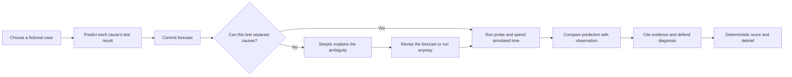
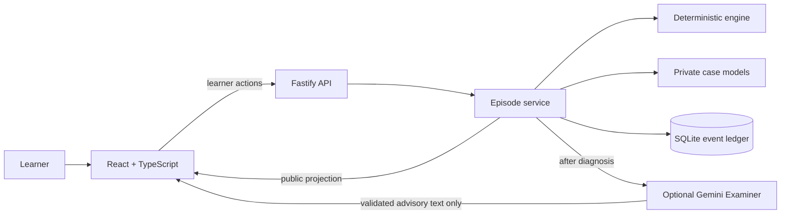

# TwinSleuth

### Practice fault diagnosis by predicting first, testing under a budget, and defending a diagnosis with evidence.

[**Watch the 5-minute demo**](https://youtu.be/elNEaO97DTY) · [**Open the Devpost submission**](https://devpost.com/software/twinsleuth) · [Learner guide](USER-GUIDE.md)

TwinSleuth is a local browser lab with two fictional maintenance cases. It gives technical learners a place to practice choosing tests and reasoning from evidence. It is not a digital twin, an industrial control system, or a validated training intervention; it does not connect to real equipment.


## What a learner does

The learner has a simulated 30-minute budget. Before a probe runs, they record what each possible cause predicts. An uninformative forecast can trigger the deterministic Skeptic. After the test, the learner compares predictions with the observation, cites evidence for each cause, and submits a diagnosis. A deterministic debrief checks the claims and shows the score breakdown.



## Cases and evidence

| Case | Practice focus | What the demo shows |
|---|---|---|
| **PIN-9 Refusal** | Separate four possible causes with six probes. | A repeated test is uninformative; P3 and P4 narrow the evidence to H1. |
| **Conveyor Index Drift** | Separate four possible causes with five probes. | A second, independent case with its own predictions and diagnostic tests. |

The submitted walkthrough follows the fixed PIN-9 path. Screenshots below show the Skeptic challenge, the checked debrief, and the second case.


## How it is built

The server keeps the selected fault and unrun forecasts private. Deterministic code owns probe outcomes, evidence validity, the remaining candidate set, budget, diagnosis, and score. SQLite stores the event ledger used to reconstruct an episode. The browser only receives public case data, committed forecasts, and observations after a probe has run.



The complete practice flow works without an AI provider or API key. The Skeptic is deterministic. The optional post-diagnosis Examiner can explain checked claims, but its output cannot change the truth, diagnosis, score, or episode state.

## Run locally

Requires **Node.js 22 or newer**. There is no hosted interactive instance.

```sh
npm ci
npm run dev
```

Open [http://127.0.0.1:5173](http://127.0.0.1:5173). The local API runs on port 5174. No provider key is needed for the practice loop.

Optional Examiner feedback uses `GEMINI_API_KEY`. Copy `.env.example` to `.env` and set the key there; it stays server-side and is ignored by Git.

## Verify the project

```sh
npm run validate:case
npm run typecheck
npm test
npm run build
npm run test:e2e
npm run capture:demo
```

The checks cover case distinguishability, scoring and event replay, privacy boundaries, the no-key learner journey, responsive behavior, keyboard use, and accessibility. Demo capture regenerates the seven screenshots in `submission/screenshots/`.

## Navigate the repository

| Path | Purpose |
|---|---|
| `src/engine/` | Deterministic diagnosis, policy, and scoring. |
| `src/server/` | API, episode ledger, private case models, and optional Examiner. |
| `src/web/` | Learner interface and design tokens. |
| `e2e/` | Browser, privacy, accessibility, and screenshot-capture coverage. |
| `submission/` | Submitted MP4, captions, screenshots, and reviewer brief. |
| `USER-GUIDE.md` | Detailed case walkthrough and control reference. |

See [submission/SUBMISSION.md](submission/SUBMISSION.md) for the demo, Devpost link, and screenshot set. The five-minute demo is also included at [submission/TwinSleuth-Demo.mp4](submission/TwinSleuth-Demo.mp4).
