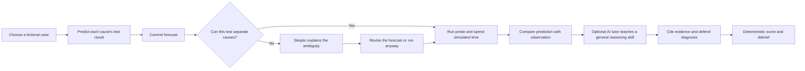
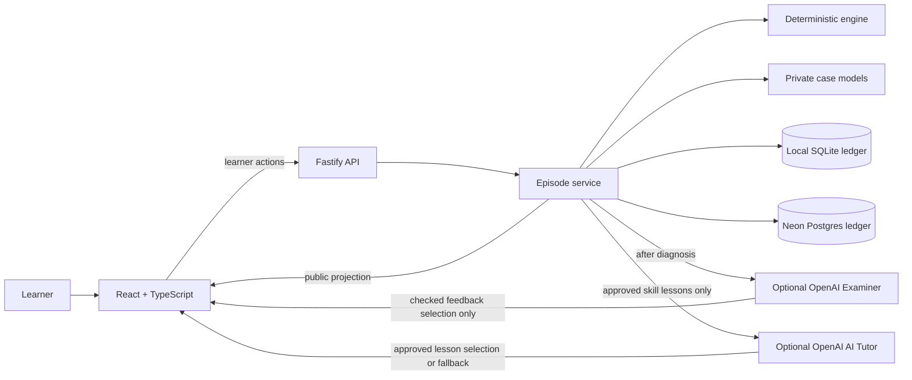

# TwinSleuth

### Practice fault diagnosis by predicting first, testing under a budget, and defending a diagnosis with evidence.

[**Try TwinSleuth online**](https://twin-sleuth.vercel.app) · [**Watch the 5-minute demo**](https://youtu.be/woYQCqpaO-Y) · [**Open the Devpost submission**](https://devpost.com/software/twinsleuth) · [Learner guide](USER-GUIDE.md)

TwinSleuth is a browser practice lab with two fictional maintenance cases. It gives technical learners a place to practice choosing tests and reasoning from evidence. It is not a digital twin, an industrial control system, or a validated training intervention; it does not connect to real equipment.

The hosted practice bench uses Neon Postgres for durable episodes and needs no account or API key for its deterministic learner flow.


## What a learner does

The learner has a simulated 30-minute budget. Before a probe runs, they record what each possible cause predicts. An uninformative forecast can trigger the deterministic Skeptic. After the test, the learner compares predictions with the observation, cites evidence for each cause, and submits a diagnosis. A deterministic debrief checks the claims and shows the score breakdown.



## Cases and evidence

| Case | Practice focus | What the demo shows |
|---|---|---|
| **PIN-9 Refusal** | Separate four possible causes with six probes. | A repeated test is uninformative; P3 and P4 narrow the evidence to H1. |
| **Conveyor Index Drift** | Separate four possible causes with five probes. | A second, independent case with its own predictions and diagnostic tests. |

The submitted walkthrough follows the fixed PIN-9 path. Screenshots below show the Skeptic challenge, the checked debrief, and the second case.


The debrief’s **Evidence claims** points measure structured citation validity. Written justification and confidence are recorded, not scored. Prediction accuracy uses first commits only for probes actually run; abandoned forecasts remain in the ledger without correctness feedback. Debrief archives include only observed probe rows. A practice score, especially on a repeated fixed case or with coaching, does not establish independent competence.

## How it is built

The server keeps the selected fault and unrun forecasts private. Deterministic code owns probe outcomes, evidence validity, the remaining candidate set, budget, diagnosis, and score. The browser only receives public case data, committed forecasts, and observations after a probe has run. Local runs use SQLite; the hosted Vercel API uses Neon Postgres for durable episode and event storage. A server-issued, HttpOnly session cookie isolates episode history, reads, exports, actions, and deletion to the owning browser. Hosted cookies are Secure and use the __Host- prefix. Clearing the cookie removes access; it does not delete stored episodes. Pre-upgrade records without ownership remain stored but are not exposed through the API.



The complete practice flow works without an AI provider or API key. The Skeptic is deterministic. The optional OpenAI AI Tutor appears after a deterministic reasoning signal and teaches a general skill without receiving case evidence, forecasts, diagnoses, scores, or learner text. The post-diagnosis Examiner selects from feedback strings derived from deterministic claim checks; arbitrary model prose is rejected. The Tutor selects an approved lesson/reflection pair for the selected skill; mixed pairs and new model prose are rejected. Baseline Examiner feedback commits with the score, and optional model focus runs after commit. Provider bodies are capped at 64 KiB before parsing, generated output at 1,024 tokens, and total inference time at six seconds for Tutor / twenty seconds for Examiner. Private ledger diagnostics record outcome reason, elapsed time, and contract version; they are excluded from learner responses and exports. Neither can change truth, diagnosis, score, or episode state. If OpenAI is unavailable, the Tutor shows a clearly labeled curated lesson. The five-minute demo uses OpenAI when `TWINSLEUTH_TESTING_MODE=0`.

## Run locally

Requires **Node.js 22 or newer**.

```sh
npm ci
npm run dev
```

Open [http://127.0.0.1:5173](http://127.0.0.1:5173). The local API runs on port 5174. No provider key is needed for the practice loop.

## Deploy

Vercel builds the Vite client and serves the Fastify API from `api/`. Neon Postgres supplies durable hosted storage through the server-side `DATABASE_URL` environment variable. The Vercel Neon integration manages that secret; never commit it. OpenAI-powered Tutor and Examiner features remain disabled unless `OPENAI_API_KEY` is configured.

Optional Tutor and Examiner feedback use the server-side `OPENAI_API_KEY` when `TWINSLEUTH_TESTING_MODE=0`. Set `TWINSLEUTH_TESTING_MODE=1` only for local testing: it uses FreeLLMPool at `FREELLMPOOL_BASE_URL` and never calls OpenAI. Start the pool with `docker compose -f docker-compose.freellmpool.yml up -d`. Copy `.env.example` to `.env`; it stays ignored by Git.

## Verify the project

```sh
npm run validate:case
npm run typecheck
npm test # includes the offline reliability evals
npm run build
npm run test:e2e
npm run capture:demo
```

The checks cover case distinguishability, scoring and event replay, privacy boundaries, the no-key learner journey, responsive behavior, keyboard use, and accessibility. Demo capture regenerates the seven screenshots in `submission/screenshots/`.

## Navigate the repository

| Path | Purpose |
|---|---|
| `src/engine/` | Deterministic diagnosis, policy, and scoring. |
| `src/server/` | API, episode ledger, private case models, and optional Examiner. |
| `src/web/` | Learner interface and design tokens. |
| `e2e/` | Browser, privacy, accessibility, and screenshot-capture coverage. |
| `submission/` | Submitted MP4, captions, screenshots, and reviewer brief. |
| `USER-GUIDE.md` | Detailed case walkthrough and control reference. |

See [submission/SUBMISSION.md](submission/SUBMISSION.md) for the demo, Devpost link, and screenshot set. The five-minute demo is also included at [submission/TwinSleuth-Demo.mp4](submission/TwinSleuth-Demo.mp4).
